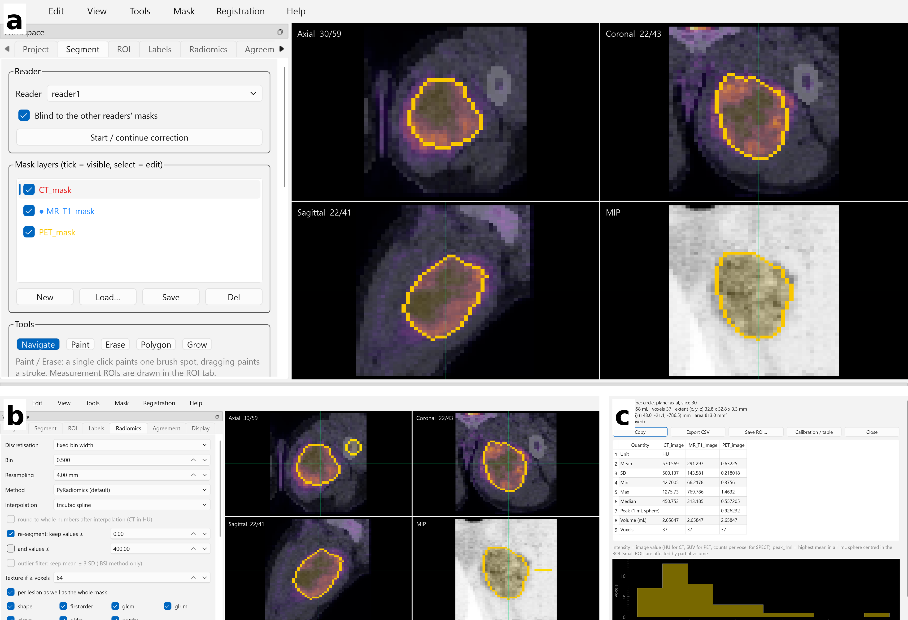

# PySegment

**An open-source desktop workstation for PET/CT segmentation, radiomics, image registration and radionuclide dosimetry, validated module by module against public reference data.**

[](LICENSE)


[](https://doi.org/10.5281/zenodo.24463598)



Quantitative nuclear medicine usually needs several programs: one to view and segment, one to extract radiomic
features, one to register follow-up scans and one to calculate absorbed doses. Every transfer between them is a chance
for error, and few of these tools report how their own numbers were checked. PySegment covers the whole chain in one
offline program, and every module that produces a reportable number has been compared with a public reference.
The scripts that do this are part of the repository, so the validation can be repeated for every new version.

> **Research use only.** PySegment is not a medical device and must not be used for diagnosis or treatment decisions.

---

## Contents

- [What it does](#what-it-does)
- [Validation at a glance](#validation-at-a-glance)
- [Installation](#installation)
- [Quick start](#quick-start)
- [Reproducing the validation](#reproducing-the-validation)
- [Repository layout](#repository-layout)
- [Design principles](#design-principles)
- [Citing PySegment](#citing-pysegment)
- [Licence and third-party software](#licence-and-third-party-software)

## What it does

| Module | Main functions |
|---|---|
| **Image input and display** | DICOM (several series in one folder are separated automatically), NIfTI, NRRD, MetaImage; PET in Bq/mL converted to body-weight SUV (QIBA definition); reconstructed SPECT and planar whole-body NM (anterior/posterior, posterior mirrored for conjugate views); three orthogonal views, MIP, PET/CT fusion; movable text labels with arrows; figures exported at 300 dpi (F12 saves any window). |
| **Segmentation** | Brush (2D/3D, size in mm), polygon, thresholds, islands removal, expansion and smoothing in mm; one-click PET region growing (absolute value or % of the local maximum) with a guard against leaking into the background; masks saved on the PET grid. |
| **Reader studies** | Projects with one mask per reader and case, blinding to the other readers, start from an automatic (e.g. neural-network) mask; Dice, Jaccard, HD95 and ICC(A,1) with confidence interval between readers. |
| **Radiomics** | PyRadiomics for the whole mask and per lesion; two processing options: *PyRadiomics default* (comparable with earlier studies) and an *IBSI-compliant* option that corrects grid alignment, mask interpolation, bin numbering, principal-axis normalisation and the Laplacian-of-Gaussian filter. |
| **Registration** | Rigid, affine (rigid-first) and B-spline (SimpleITK); elastix engine with a lung-motion profile for 4D CT; landmark registration with the Fitzpatrick error prediction; hybrid PET/CT and SPECT/CT (register the CTs, apply to the functional image); safeguards: never worse than the start, warning when not converged, folding check. |
| **Quantification and dosimetry** | ROI statistics including SUVpeak (PERCIST); SPECT counts → activity with stored calibration profiles; time-integrated activity (trapezoids with exponential tail, mono- and bi-exponential fits bounded by physical decay); absorbed dose with user S-values (MIRD organ matrix) or local energy deposition from ICRP 107 nuclear data; RBE weighting for alpha emitters; effective dose (ICRP 103 / ICRP 60). |

## Validation at a glance

Public data only. Full methods, tables and every computed value: [`validation/`](validation/).

| Module | Reference | Result |
|---|---|---|
| Radiomics, IBSI 1 | Digital phantom; chest CT configurations C, D, E | IBSI option: 102/102, 102/102, 99/102, 102/102 features within tolerance |
| Radiomics, IBSI 2 | Filter response maps; filtered features | Wavelets exact in every voxel; LoG ≤ 0.002; phase 2: 15/15 (1.B and 3.B) |
| SUV and ROI statistics | QIBA FDG-PET/CT DRO (female and male) | 48/48 values within the acceptance bounds |
| SUVpeak, PET/CT fusion | QIBA DROe | SUVpeak equal to an independent reference; fusion offset 0.0 mm |
| Metabolic tumour volume | QIBA DROmtv (true partial-volume volumes) | Half-way threshold ≤ 5 % error for all 14 uniform objects (noise-free) |
| Registration, known transforms | 51 real PET/CT/MR studies (IBSI STS set) | Median TRE: CT rigid 0.39 mm, affine 0.30 mm; PET affine 0.17 mm; B-spline 0.55–0.56 mm |
| Registration, expert landmarks | POPI 4D CT (6 patients, ~100 landmarks each) | Test patients: 8.74 → 1.25 mm (settings fixed on separate tuning patients) |
| Landmark registration | Fitzpatrick TRE prediction | Observed/predicted 0.988 |
| SPECT quantification | Analytic phantom | Activity exact to machine precision; counts conserved within 0.1 % |
| Nuclear data | ICRP Publication 107 | 23 mean energies within 0.16 % |
| S-values | EANM / IDAC-Dose 2.1 (Lu-177) | Kidneys, spleen within 1 %; liver −3.8 % |
| Agreement metrics | Exact geometry; SimpleITK, MedPy, pingouin | Identical values |

The validation also found **seven errors** in earlier versions (for example a missing Lu-177 photon energy, an
unbounded bi-exponential fit, a region-growing leak at low contrast and an optimiser that stopped before converging).
Each was corrected and is now covered by a regression test; the details are in [`validation/`](validation/).

## Installation

**Windows installer (recommended).** Download `PySegment_Setup_v*.exe` from the
[latest release](../../releases/latest) and run it. No administrator rights are needed; everything,
including the elastix engine, is included. Every installer is built, installed and self-tested automatically before
it is published.

**From source (Windows, Linux, macOS).**

```bash
git clone https://github.com/kazimradfar/PySegment.git
cd PySegment
python -m venv .venv && .venv\Scripts\activate          # Linux/macOS: source .venv/bin/activate
pip install -r requirements-desktop.txt
pip install --no-deps "pyradiomics @ git+https://github.com/AIM-Harvard/pyradiomics.git"   # the PyPI build is broken
python -m rsw
```

Python 3.13 is tested. A self-test of an installation: `python -m rsw --self-test result.json`.

## Quick start

1. **Open data**: *File → Open DICOM folder…* (any folder with PET/CT, SPECT or MRI series), *File → Open images…*
   (NIfTI and others), or *File → Open project folder…* for a study with one sub-folder per patient.
2. **Segment**: *Segment* tab: brush (P), polygon (L), region growing (G: click a lesion), thresholds, morphology.
3. **Measure**: *ROI* tab: draw ROIs; with the Navigate tool, click inside one for its statistics and histogram.
4. **Radiomics**: *Radiomics* tab: choose the processing option and settings, compute, export CSV.
5. **Register**: *Registration → Register images…*: engine, mode, start; check the fusion; accept or reject.
6. **Dosimetry**: *Tools → Dosimetry*: enter the activity of each scan (from the ROI details) and its time, choose the method.
7. **Figures**: *Labels* tab for arrows and text; *File → Save window as image…* or **F12** in any window.

**User manual:** [`docs/manual/PySegment_User_Manual.docx`](docs/manual/PySegment_User_Manual.docx) (complete, with screenshots). Short references: [`rsw/README.md`](rsw/README.md) (English) and [`rsw/README_FA.md`](rsw/README_FA.md) (Persian).

## Reproducing the validation

Download the public data sets, then run the scripts in [`tools/`](tools/). Each writes its tables and a
`summary.json` (with the code version) into `validation/<step>/`.

| Step | Data | Command |
|---|---|---|
| IBSI 1 | [IBSI data sets](https://github.com/theibsi/data_sets) | `python tools/validate_ibsi1.py --data <ibsi_1> --ref <reference values>` |
| IBSI 2 | [MIRP test suite](https://github.com/oncoray/mirp) | `python tools/validate_ibsi2.py --mirp-test <mirp/test> --data <ibsi_2>` |
| QIBA DRO | [UW QIBA DRO](https://depts.washington.edu/petctdro/) | `python tools/validate_qiba_dro.py --dro <DRO> --droe <DROe> --dromtv <DROmtv>` |
| Registration (51 studies) | IBSI STS set (`ibsi_validation/nifti`) | `python tools/validate_registration.py --data <nifti> --jobs 4 --bspline-ct 6` |
| Registration (POPI) | POPI 4D CT (CREATIS, Lyon) | `python tools/validate_registration_landmarks.py --popi <folder>` |
| Dosimetry | ICRP 107 files ([RadData](https://github.com/markhogue/RadData)) | `python tools/validate_dosimetry.py --icrp107 <RadData/data>` |
| Agreement metrics | none (synthetic) | `python tools/validate_agreement.py` |
| SPECT counts | none (synthetic) | `python tools/validate_spect_counts.py` |

Unit and window tests (synthetic data only): `python -m pytest tests -q`.

## Repository layout

```
rsw/            program: computational modules (no user interface) and rsw/gui (Qt windows)
tests/          automated tests, synthetic data only
tools/          validation scripts
validation/     validation plan, results and per-step READMEs
docs/           user manual (Word, with screenshots) and images
installer/      Inno Setup script for the Windows installer
rsw.spec        PyInstaller specification
```

## Design principles

- **Offline.** Images, masks and results never leave the computer; there is no telemetry.
- **No silent failures.** A registration that ends worse than its start, does not converge or folds the image is
  reported; a region that would leak into the background is refused; a PET series that is not decay-corrected to the
  acquisition start is not converted to SUV.
- **Transparent definitions.** Where a library departs from a standard (PyRadiomics versus IBSI, HD95 surface
  definitions), the program says so and offers the standard definition.
- **Open files.** Masks are NIfTI on the PET grid, features CSV, settings and results JSON, so every result can be
  checked in other software.
- **Repeatable validation.** Each module is compared with a public reference by a script that can be run again for
  every new version.

## Citing PySegment

A paper describing PySegment and its validation is in preparation. Until it is published, please cite this repository:

```bibtex
@software{radfar_pysegment,
  author  = {Radfar, Kazim},
  title   = {PySegment: an open-source desktop workstation for PET/CT segmentation, radiomics,
             registration and radionuclide dosimetry},
  year    = {2026},
  version = {0.1.2},
  doi     = {10.5281/zenodo.24463598},
  url     = {https://github.com/kazimradfar/PySegment},
  license = {MIT}
}
```

## Licence and third-party software

PySegment is released under the [MIT licence](LICENSE). It builds on open-source libraries, among them Qt for Python
(PySide6, LGPLv3, used as separate replaceable libraries), pyqtgraph, NumPy, SciPy, pandas, pydicom, SimpleITK,
elastix / itk-elastix and PyRadiomics; see [`rsw/THIRD_PARTY_NOTICES.txt`](rsw/THIRD_PARTY_NOTICES.txt).

Public reference data used for the validation were made available by the Image Biomarker Standardisation Initiative,
the QIBA / University of Washington digital reference objects, CREATIS and the Léon Bérard Cancer Centre (POPI) and
the contributors of the TCIA soft-tissue sarcoma collection.

**Author:** Kazim Radfar, Medical Physics, Tehran University of Medical Sciences.
Questions and bug reports: please open an [issue](../../issues).
