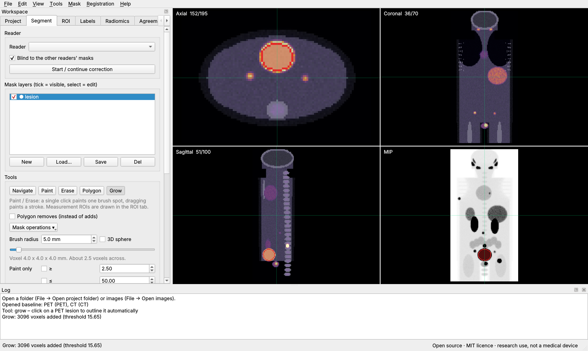
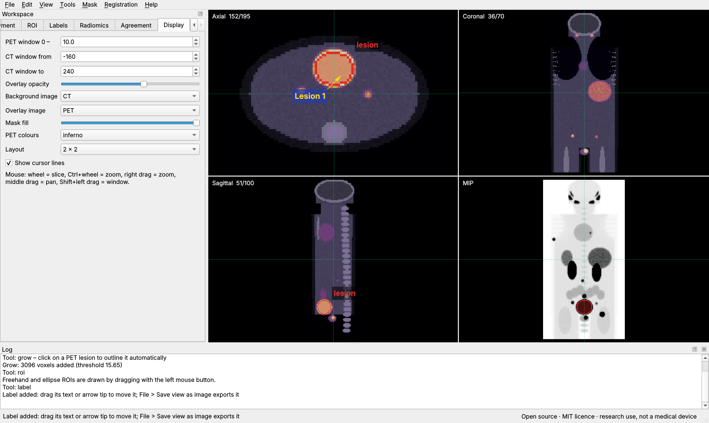
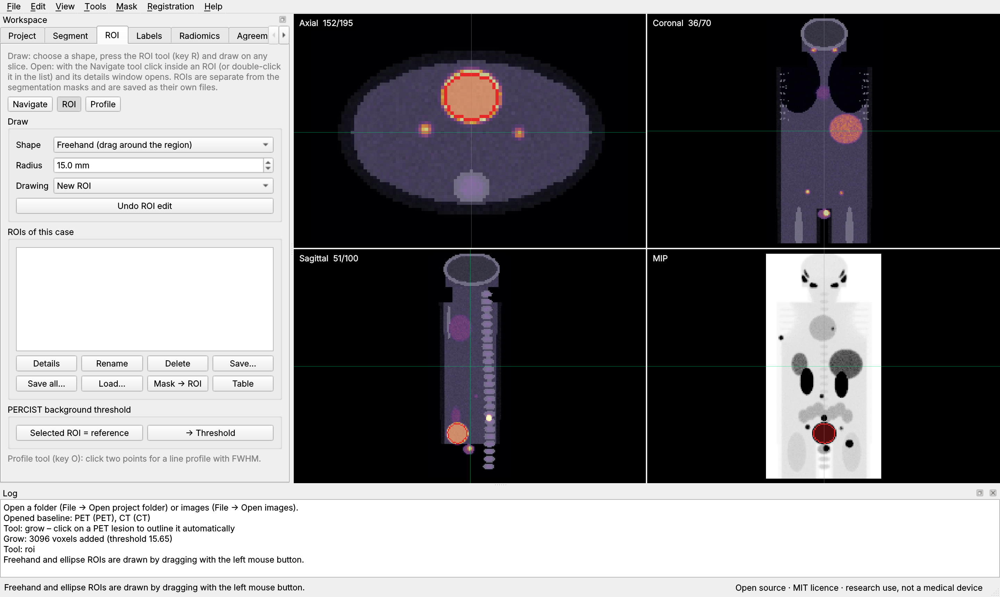
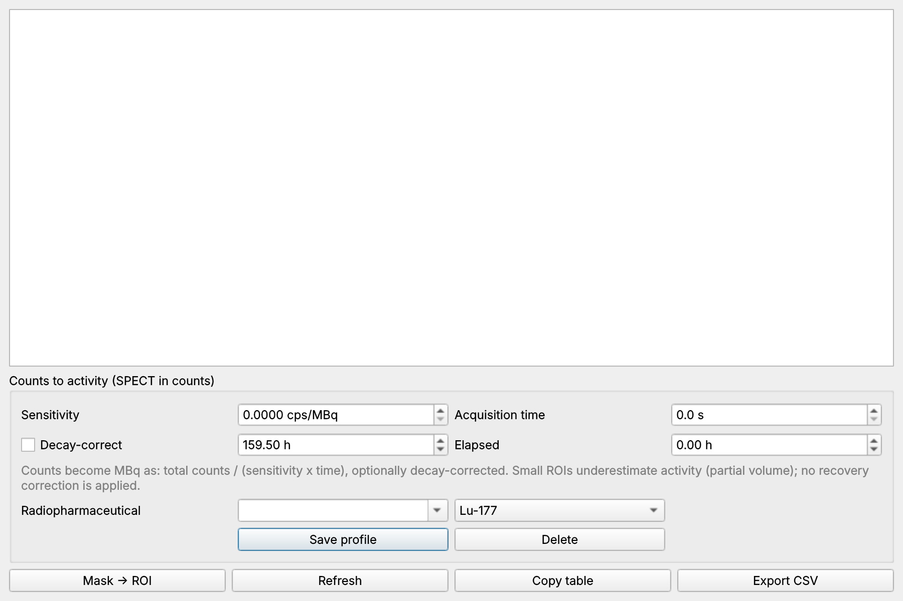
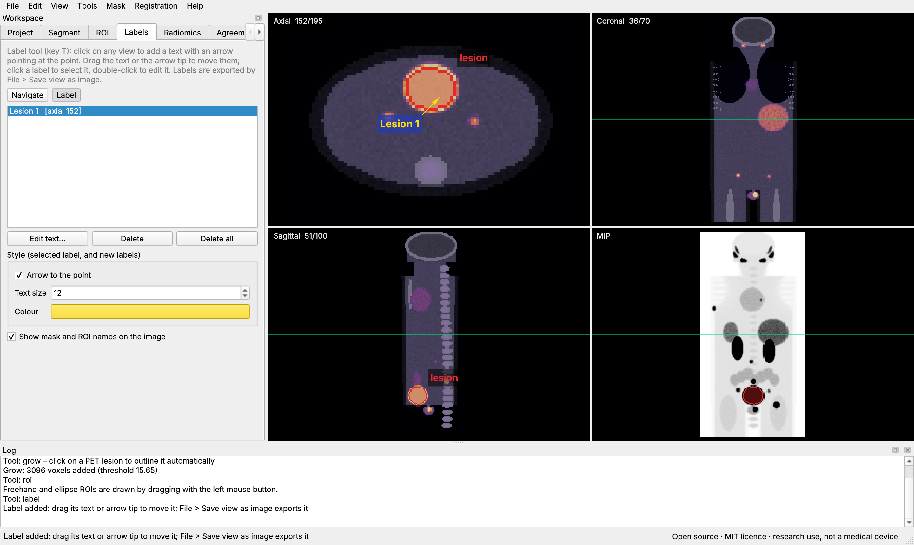
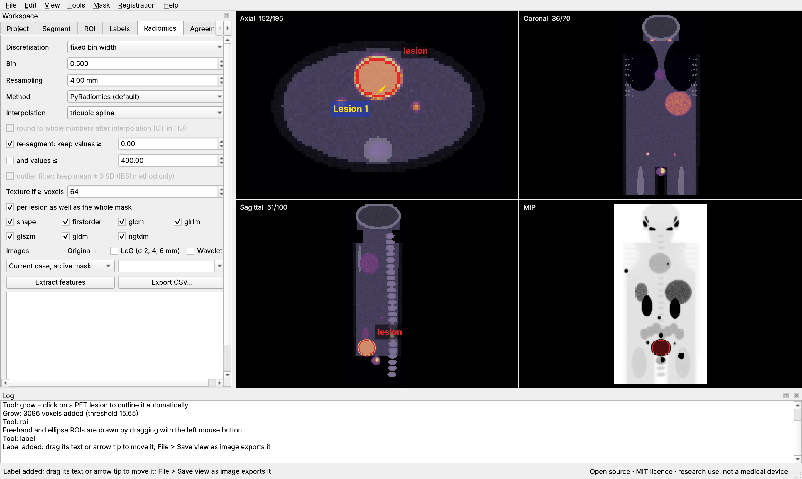
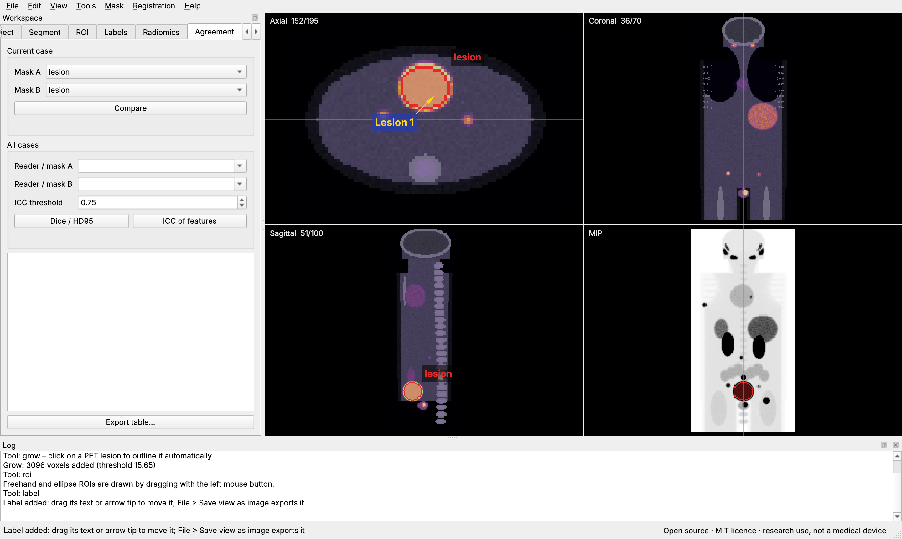
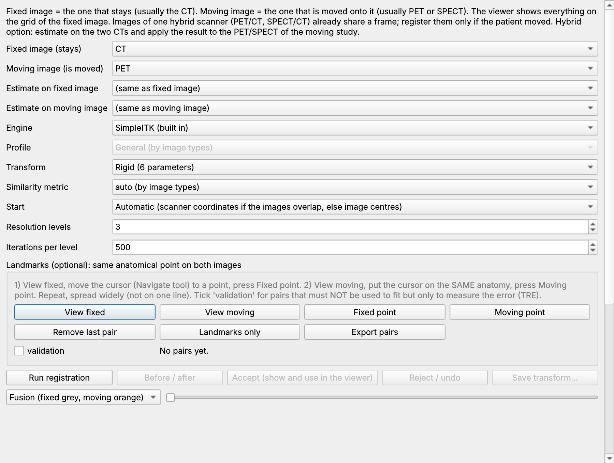
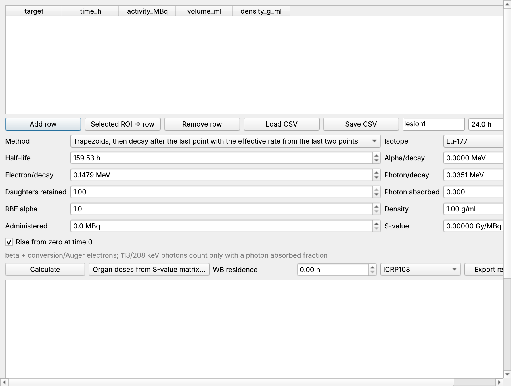

Kazim Radfar, Habibeh Vosoughi, Elmira Yazdani and Mohammad Reza Ay

Department of Medical Physics and Biomedical Engineering, School of Medicine, Tehran University of Medical Sciences

Software: https://github.com/kazimradfar/PySegment · Archived version: https://doi.org/10.5281/zenodo.24449581 · Licence: MIT

> **Research use only.** PySegment is not a medical device. It must not be used for diagnosis, treatment planning or any other clinical decision. Every result should be checked by a qualified person.

The screenshots in this manual show a synthetic patient created by `tools/make_realistic_demo.py`; they contain no patient data.

# About PySegment

PySegment is an open-source desktop program for quantitative nuclear medicine imaging. In one window it lets you view PET, SPECT, CT and MRI; segment lesions by hand or semi-automatically; run reader studies with several readers and blinding; measure regions of interest (ROIs); compute radiomic features; register images of different times or modalities; and estimate organ- and lesion-level absorbed doses from activities measured at several times.

The program was written for research in radioligand therapy (for example [¹⁷⁷Lu]Lu-PSMA), but it is general: any PET/CT, SPECT/CT, CT or MRI study can be opened. It runs offline: images, masks and results never leave the computer, and nothing is sent over the internet.

Every module that produces a number has been validated against public reference data (IBSI, QIBA digital reference objects, real PET/CT/MR studies with known transforms, the POPI 4D CT model, ICRP 107 and EANM S-values). The scripts and results are part of the repository (folder `validation`), and Section 15 summarises them.

**How to cite.** Please cite the archived version, https://doi.org/10.5281/zenodo.24449581, and the accompanying article once it is published.

# Installation

## Windows installer (recommended)

1. Open https://github.com/kazimradfar/PySegment/releases and download `PySegment_Setup_v0.1.1.exe` (about 160 MB).
2. Run it. Administrator rights are not needed; the program is installed for the current user.
3. Read and accept the MIT licence, choose the folder and finish. A shortcut *PySegment* appears in the Start menu.

The installer contains everything, including Python, PyRadiomics and the elastix registration engine. About 1.1 GB of disk space is needed. Every installer is built, installed and self-tested automatically before it is published.

**Uninstall:** Windows Settings → Apps → PySegment → Uninstall. Your settings (`%APPDATA%\PySegment`) and your data are not removed.

## From source (Windows, Linux, macOS)

```
git clone https://github.com/kazimradfar/PySegment.git
cd PySegment
python -m venv .venv
.venv\Scripts\activate            (Linux/macOS: source .venv/bin/activate)
pip install -r requirements-desktop.txt
pip install --no-deps "pyradiomics @ git+https://github.com/AIM-Harvard/pyradiomics.git"
python -m rsw
```

Python 3.13 is tested. PyRadiomics is installed from GitHub because the release on PyPI does not install on recent Python versions.

## Checking an installation

`python -m rsw --self-test result.json` (or `PySegment.exe --self-test result.json`) runs a short test of image input, SUV conversion, segmentation, radiomics and the elastix engine and writes the results to `result.json`. All checks should be `true`.

# Quick start

1. **Open data.** *File → Open DICOM folder…* and choose the folder of a PET/CT study. If it contains several series, tick PET and CT (they are ticked already) and press OK. PET is converted to SUV and fused with CT.
2. **Find a lesion.** Scroll through the slices with the mouse wheel; the four views (axial, coronal, sagittal, MIP) follow the cursor.
3. **Segment it.** In the *Segment* tab press *New* to create a mask layer, choose the *Grow* tool (key G) and click the lesion. The lesion is outlined automatically; correct it with *Paint* (P) and *Erase* (E).
4. **Measure it.** In the *ROI* tab draw an ROI, or with *Navigate* (N) click inside it: the ROI details window shows SUVmax, SUVmean, SUVpeak, volume and the histogram.
5. **Compute features.** In the *Radiomics* tab choose the settings and press *Extract features*; *Export CSV…* saves the table.
6. **Save.** Ctrl+S saves the active mask as a NIfTI file.
7. **Make a figure.** In the *Labels* tab add text with an arrow; *File → Save window as image…* or F12 saves the window at 300 dpi.

# The main window

{width=16cm}

The window has five parts:

* **Menu bar:** File, Edit, View, Tools, Mask, Registration and Help.
* **Workspace (left):** seven tabs — Project, Segment, ROI, Labels, Radiomics, Agreement and Display. The panel can be detached or moved.
* **Viewer (centre):** axial, coronal and sagittal slices and the MIP. The layout can be changed in the Display tab (2 × 2, axial only, coronal only, axial + MIP).
* **Log (bottom):** every action and result, with numbers (for example the threshold used by region growing).
* **Status bar:** short messages and the licence notice.

## Mouse and keyboard

| Action | How |
|---|---|
| Change slice | Mouse wheel |
| Zoom | Ctrl + wheel, or right-button drag |
| Pan | Middle-button drag |
| Window / level | Shift + left-button drag |
| Reset zoom | Ctrl+0 |
| Navigate / Paint / Erase | N / P / E |
| Polygon / Grow | L / G |
| ROI / Profile / Label | R / O / T |
| Brush larger / smaller | ] / [ |
| Undo / Redo | Ctrl+Z / Ctrl+Y |
| Save active mask | Ctrl+S |
| Open project folder | Ctrl+O |
| Save the window in front as an image | F12 |

A click with the *Navigate* tool moves the cross-hair of all views to that point and shows the values of every image there in the status bar.

# Opening data

## DICOM folders

*File → Open DICOM folder…* searches the chosen folder and all its sub-folders for image series. Several series in one folder (a typical PET/CT export) are separated automatically by their series identifier. With more than one series a list appears: each line shows modality, description and number of files; PET, SPECT and CT are ticked. Untick what you do not need and press OK.

What happens on opening:

* **PET in Bq/mL is converted to body-weight SUV**, using the patient weight, injected activity, injection time and half-life in the DICOM header, with decay corrected to the start of the acquisition (QIBA definition). Series that are not decay-corrected to the acquisition start are refused rather than converted wrongly; use *File → DICOM header and SUV check…* to see why.
* **Reconstructed SPECT** is kept in counts (or Bq/mL if the scanner stored it so). Counts can be converted into activity in the ROI table (Section 8.5).
* **Planar whole-body or static NM** (anterior and posterior views) opens as two images, *NM ANT* and *NM POST*, in one large coronal view. The posterior view is mirrored so that both are shown in the same anatomical orientation, as needed for conjugate-view quantification.
* All images are resampled to one grid in a standard orientation; the original images are kept and used for every calculation that needs them.

## Image files

*File → Open images…* opens NIfTI (.nii, .nii.gz), NRRD and MetaImage (.mha, .mhd) files. Choose several files at once (for example PET and CT) to see them fused. The kind of image (PET, CT, MR, SPECT) is guessed from the file name and can be changed in the Display tab.

## Project folders

A project is a folder with one sub-folder per patient (case). *File → Open project folder…* (Ctrl+O) or the *Project* tab opens it; the cases are listed and opened by a double-click. Two layouts are recognised:

* **Generic:** `<project>/<case>/` with image files or DICOM folders. Masks are files whose name contains *mask*, *seg*, *label*, *roi* or *lesion*, or files in `<case>/masks/`. A mask whose name contains *auto* is used as the starting point for readers. Reader masks are stored as `<case>/masks/<structure>_<reader>.nii.gz`.
* **PSMA pipeline layout:** `data/nifti/<case>/PET_SUV.nii.gz, CT.nii.gz` with masks in `data/masks/<case>/`.

A single folder with images is treated as one case. The readers and the structure name of a project are stored in `rsw_project.json` in the project folder (*Project* tab → *Save project settings*).

{width=16cm}

## DICOM tools

* **File → DICOM header and SUV check…** shows the header of a series and every value used for SUV (weight, activity, times, units, decay correction), so a wrong SUV can be traced.
* **File → Anonymise DICOM folder…** writes an anonymised copy of a DICOM folder into an empty folder. Name, ID, birth date, address, institution, physicians and accession and study numbers are replaced by a study code or removed; private tags are removed; all identifiers (UIDs) are replaced consistently. Weight, dose, half-life and times are kept, so SUV can still be calculated. Optionally every date is shifted by a number of days. Text burned into the pixels is not removed: check the images before sharing them.
* **File → Export images as NIfTI…** saves the open images as NIfTI files.

# Display

{width=16cm}

* **Background image / Overlay image:** which image is shown in grey and which in colour on top of it (for example CT and PET).
* **PET window 0 – …** and **CT window from … to …:** display ranges. Shift + left drag in a view changes the window of the background image.
* **Overlay opacity:** transparency of the colour image.
* **PET colours:** colour table of the overlay.
* **Mask fill:** filled masks or outlines only.
* **Show cursor lines:** the cross-hair in all views.
* **Layout:** 2 × 2, Axial, Coronal or Axial + MIP.

# Segmentation

The *Segment* tab holds everything needed to create and correct masks.

## Mask layers

A case can have several masks, called layers (for example *lesions*, *liver*, *kidney_left*). In the list, the tick box shows or hides a layer and the selected layer is the one that is edited.

* **New:** an empty layer. **Load…:** a mask file (NIfTI, NRRD; resampled to the image grid if needed). **Save:** the selected layer as NIfTI on the PET grid (also Ctrl+S). **Del:** removes the layer from the case (not the file).

## Tools

| Tool | Key | Use |
|---|---|---|
| Navigate | N | Move the cross-hair; click inside an ROI to see its details. |
| Paint | P | Add voxels with the brush. A click paints one spot, dragging paints a stroke. |
| Erase | E | Remove voxels with the brush. |
| Polygon | L | Click the corners of a polygon; *Tools → Close polygon* fills it, *Cancel polygon* discards it. With *Polygon removes* ticked, the polygon removes voxels. |
| Grow | G | One-click region growing on PET (see below). |

**Brush:** *Brush radius* in millimetres (] and [ change it); *3D sphere* paints a sphere instead of a disc. **Paint only where value ≥ … and ≤ …** restricts the brush to voxels in a range of the PET (for example SUV ≥ 2.5), so the brush cannot leak into background.

**Region growing (Grow):** click a lesion. PySegment finds the maximum within 10 mm of the click and adds the connected region (26-neighbour) around it whose values are above the threshold. The threshold is either a percentage of that local maximum (default 41 %) or an absolute value (for example SUV 2.5). The log shows the threshold and the number of voxels. For low-contrast lesions a percentage of the maximum can fall to background level; PySegment then refuses the threshold (below 1.5 times the median background in a 4–12 mm shell around the region) instead of returning a region that floods the background.

**Morphology:** *Islands <* … voxels removes small unconnected pieces; *Threshold* keeps only voxels above a value; *Smooth* smooths the outline; *Expand ±* … mm grows or shrinks the mask by a distance. *Undo* and *Redo* (Ctrl+Z, Ctrl+Y) work for every edit.

**Mask menu:** Fill holes (each slice), Fill 3D cavities, Keep largest part, Fill between slices (interpolate between slices drawn by hand), Clear active mask, Duplicate layer, and Union, Intersection or Subtraction with another layer.

**List lesions of the active mask:** lists the connected lesions of a mask with their volume and values; a double-click moves the views to the lesion.

## Reader studies

Reader studies measure how much masks differ between readers.

1. In the *Project* tab enter the readers (for example R1, R2) and the structure name, and save the project settings.
2. Each reader chooses his or her name in *Segment → Reader* and presses *Start / continue correction*. The reader starts from the automatic mask of the case (if there is one) or from an empty mask, and later continues from his or her own saved mask.
3. With *Blind to the other readers' masks* ticked, the masks of the other readers are hidden.
4. The mask is saved as `<case>/masks/<structure>_<reader>.nii.gz`.

The *Agreement* tab (Section 11) then compares the readers.

# ROIs and measurements

{width=16cm}

## Drawing ROIs

In the *ROI* tab choose the *ROI* tool (R) and a shape: freehand, polygon, ellipse, circle (2D) or sphere (3D). Circle and sphere ROIs have a radius in millimetres (15 mm = 3 cm diameter, the PERCIST liver reference). Drag in a view to draw; *Undo ROI edit* removes the last change. ROIs are listed under *ROIs of this case* and can be renamed and deleted there. ROIs are separate from masks: they are measurement regions and are not changed by the segmentation tools.

## ROI details

With the *Navigate* tool, click inside an ROI (or double-click it in the list). The *ROI details* window shows, for every open image, the mean, SD, minimum, maximum, median, volume and total within the ROI, the SUVpeak and the intensity histogram. **SUVpeak** is the highest mean in a 1 mL sphere centred anywhere in the ROI (PERCIST). *Tools → ROI table (all ROIs)…* (or *Table* in the ROI tab) shows the same values for all ROIs in one table, with the counts-to-activity conversion (Section 8.5), and *Export CSV* saves it.

## PERCIST background threshold

Draw a 3 cm sphere in normal liver, select it and press *Selected ROI = reference*. *→ Threshold* puts 1.5 × mean + 2 × SD of the reference into the Threshold field of the Segment tab, so that lesions can be segmented with the PERCIST threshold.

## Line profile

The *Profile* tool (O): click two points. A window shows the profile along the line and its full width at half maximum (FWHM), useful for resolution and partial-volume checks.

## Counts to activity (SPECT)

The ROI table (*Tools → ROI table*) converts SPECT counts into activity with a system sensitivity: $A = N / (S \cdot t_{\mathrm{acq}})$, with $N$ the counts in the ROI, $S$ the sensitivity in counts per second per MBq and $t_{\mathrm{acq}}$ the acquisition time. Sensitivities are stored as calibration profiles per radiopharmaceutical and isotope (*Save profile*, *Delete*) in `~/.pysegment/calibrations.json`. The elapsed time since administration is entered with the acquisition time. Decay to the time of administration is not corrected, because physical decay is part of the time–activity curve used for dosimetry.

{width=14cm}

# Labels and figures

{width=16cm}

**Labels.** In the *Labels* tab choose the *Label* tool (T) and click on any view; type a text. The text is drawn with an arrow pointing at the clicked point.

* Drag the **text** to move it; the arrow keeps pointing at the same point.
* Drag the **arrow tip** to change the point; the text stays where it is.
* Click a label to select it (blue background); double-click to edit its text.
* The list shows all labels with their view and slice; a click moves the view to the label's slice. *Edit text…*, *Delete* and *Delete all* act on the labels.
* *Style:* arrow on or off, text size and colour, for the selected label and for new labels.
* *Show mask and ROI names on the image* writes the name of each mask and ROI next to it.

Labels are kept while the case is open; they are not saved with the masks.

**Figures.** *File → Save view as image…* saves the image views; *File → Save window as image…* saves the whole program window; **F12** saves whichever window is in front, including dialogs such as registration, dosimetry or ROI details. Images are drawn again at three times the screen resolution (not enlarged pixels) and marked 300 dpi, with labels and names, so they can be used directly in publications. Before saving a figure for publication, check that no folder path, patient name or other identifying text is visible.

**Smoothed images.** *Tools → Gaussian filter…* creates a new, smoothed copy of an image with a Gaussian of chosen σ in millimetres (FWHM = 2.355 σ). The copy can be shown and measured like any image, for example to simulate a lower resolution.

# Radiomics

{width=16cm}

The *Radiomics* tab computes features with PyRadiomics for the active mask.

**Settings:**

* **Images:** which images to use (for example PET and CT).
* **Original + filters:** features of the original image and, optionally, of Laplacian-of-Gaussian images (σ 2, 4 and 6 mm) and wavelet images.
* **Discretisation:** fixed bin width (for example 0.5 SUV for PET, 25 HU for CT) or fixed bin number.
* **Resampling:** voxel size after resampling (for example 4 mm isotropic for PET) and the interpolation.
* **Re-segmentation:** keep only values ≥ … and ≤ … (for example CT −1000 to 400 HU); *round to whole numbers after interpolation* (CT); *outlier filter* (mean ± 3 SD).
* **Per lesion as well as the whole mask:** features for every connected lesion in addition to the whole mask.
* **Texture if ≥ … voxels:** texture features only for lesions with at least this many voxels (for example 64); smaller lesions get shape and intensity features only.
* **Method:** *PyRadiomics default* or *IBSI*.

**Default or IBSI?** PyRadiomics departs from the IBSI definitions in three places: it aligns the resampled grid with the corner of the region and resamples the mask with nearest-neighbour interpolation; it numbers fixed-size bins from the minimum of the region instead of the lower bound of the re-segmentation range; and it normalises the principal-axis covariance by N instead of N − 1. The *IBSI* option corrects all three and computes the Laplacian-of-Gaussian filter as defined by IBSI 2. With the IBSI option PySegment reproduced 99–102 of 102 features of every IBSI 1 reference data set. Use *IBSI* when results are to be compared with other software or reported as IBSI-compliant; use *default* to stay comparable with earlier PyRadiomics results. In either case, report the option and all settings; they are saved with the results.

**Run and export.** *Extract features* runs in the background (the log shows progress); the table appears in the tab and *Export CSV…* saves it, one row per mask or lesion and one column per feature, with a file `<name>_settings.json` next to it that records every setting and the PyRadiomics version.

# Agreement between readers

{width=16cm}

* **Current case:** choose *Mask A* and *Mask B* and press *Compare*: Dice, Jaccard, 95th-percentile Hausdorff distance (HD95) and the volumes.
* **All cases:** choose two readers: *Dice / HD95* compares their masks in every case; *ICC of features* computes the intraclass correlation ICC(A,1) (two-way, absolute agreement, single measure) of every radiomic feature with its 95 % confidence interval, and marks features below the *ICC threshold* (for example 0.75).
* **Export table…** saves the results as CSV.

Definitions: Dice = 2|A∩B| / (|A| + |B|); Jaccard = |A∩B| / |A∪B|; HD95 = 95th percentile of the surface distances in both directions, with surfaces defined by 26-neighbour connectivity, in millimetres. HD95 values of other programs may differ if they use another surface definition; report it.

# Image registration

Registration aligns one image (the *moving* image) to another (the *fixed* image), for example a follow-up PET/CT to the baseline, or SPECT to CT. *Registration → Register images…* opens the dialog.

{width=14cm}

## Settings

* **Fixed image (stays)** and **Moving image (is moved)**. The viewer shows everything on the grid of the fixed image.
* **Estimate on fixed / moving image:** the images used to compute the transform. For serial PET/CT or SPECT/CT choose the CTs (the *hybrid* option): the transform is estimated on the two CTs and applied to the PET or SPECT of the moving study. This is more robust than registering functional images directly.
* **Engine:** *SimpleITK* (built in) or *elastix*.
* **Profile** (elastix only): *General* or *Lung motion* (for CT phases of a breathing cycle: 2 mm grid, lung mask, normalised correlation, 10 mm B-spline grid).
* **Transform:** *Rigid* (6 parameters: rotations and shifts), *Affine* (12: also scaling and shear; starts from a rigid registration) or *B-spline* (smooth deformation).
* **Similarity metric:** *auto* chooses mutual information for different modalities and correlation for images of the same kind.
* **Start:** *Automatic* (scanner coordinates if the images overlap by at least half, otherwise aligned image centres), *scanner coordinates*, *image centres* or *landmarks*.
* **Resolution levels** (default 3) and **Iterations per level** (default 500; the optimiser stops earlier when it converges).

## Running and checking

Press *Run registration*. When it has finished, the fused result is shown; *Before / after* switches between the original and the registered image, and the fusion slider changes the mix. Check the alignment on bones, organ outlines and lesions in all three views.

* **Accept** uses the registered image in the viewer and for measurements. **Reject / undo** discards it.
* **Save transform…** saves the transform as a file; *Registration → Load transform file…* applies a saved transform; *Remove registration of an image…* returns to the original image.

## Warnings

PySegment never hides a failed registration:

* *The start was kept:* the result matched worse than the starting position, so the start was kept. Try another start or landmarks.
* *Not converged:* the optimiser reached its iteration limit while the transform was still moving. Increase the iterations or check the result carefully.
* *Large correction:* the transform moved the image by more than 20 mm. Check that this is plausible.
* *Folding:* a B-spline transform folds the image in some voxels; do not use it for quantification.

## Landmarks

The lower part of the dialog registers images by paired anatomical points:

1. *View fixed*, move the cursor (Navigate tool) to a point, press *Fixed point*.
2. *View moving*, put the cursor on the same anatomy, press *Moving point*.
3. Repeat for at least three, better six, points spread widely in three dimensions (not on one line).

*Landmarks only* computes the transform from the points; otherwise they give the start of an intensity registration. Points marked *validation* are not used for the fit but measure the target registration error (TRE); the dialog also shows the error expected from the point configuration (Fitzpatrick prediction). *Export pairs* saves the points.

## Accuracy

With known transforms on 51 real studies the median error was 0.39 mm (rigid CT), 0.30 mm (affine CT), 0.17 mm (affine PET) and 0.55 mm (B-spline PET); with the lung-motion profile the landmark error in independent 4D CT test patients was 1.25 mm. MR-to-CT registration of small fields of view was not reliable; use landmarks there.

# Dosimetry

*Tools → Dosimetry (activity over time → dose)…* estimates time-integrated activities and absorbed doses from activities measured at several times.

{width=15cm}

## Time points

The table has one row per target and time: *target* (organ or lesion name), *time_h* (hours after administration), *activity_MBq*, *volume_ml* and *density_g_ml*. Rows are added with *Add row*, or with *Selected ROI → row*, which takes the activity and volume of the ROI selected in the ROI tab at the time entered next to the button. Tables can be loaded and saved as CSV (*Load CSV*, *Save CSV*).

## Kinetics (Method)

* **Trapezoids** between the points, from zero at the time of administration (*Rise from zero at time 0*), followed by an exponential tail after the last point with the effective rate of the last two points, or with physical decay only.
* **Mono-exponential fit**.
* **Bi-exponential fit**.

Fitted and extrapolated components can never clear more slowly than physical decay; this prevents the very large integrals that unconstrained fits can give with noisy data. With a first measurement at 24 h, trapezoids underestimate fast-uptake curves by up to 14 %; a mono-exponential fit is then preferable.

## Isotope and dose

* **Isotope:** Lu-177, Y-90, I-131, Ac-225, Ra-223, Tc-99m, F-18, Ga-68 or *custom*. Half-life and mean energies per decay (alpha, electron, photon) come from ICRP Publication 107; they can be changed.
* **Daughters retained:** fraction of the energy of short-lived daughters deposited at the target (alpha emitters).
* **Photon absorbed:** fraction of the photon energy absorbed locally (0 = electrons and alpha only).
* **RBE alpha:** optional relative biological effectiveness; gives a second dose in Gy(RBE).
* **Density** (g/mL) gives the mass from the ROI volume.
* **Administered** activity (MBq) gives residence times and Gy/GBq.
* **S-value:** a user S-value instead of local deposition.

The absorbed dose is $D = \tilde{A} \cdot S$. With local energy deposition, $S = \bar{E}/m$, where $\bar{E}$ is the mean energy absorbed per decay and $m$ the mass of the target. Local deposition agreed within 1 % with IDAC-Dose 2.1 for kidneys and spleen; it underestimates the liver slightly (−4 %) and is not valid for red marrow, for which PySegment gives a warning.

## Organ doses and effective dose

*Organ doses from S-value matrix…* loads a CSV of S-values (target, source) exported from OLINDA/EXM, IDAC-Dose or MIRDcalc (these data are not distributed with PySegment) and computes $D(\mathrm{target}) = \sum \tilde{A}(\mathrm{source}) \cdot S(\mathrm{target} \leftarrow \mathrm{source})$. Sources without S-values are reported, not ignored. *WB residence* gives the remainder of body (whole body minus the organs entered). The effective dose uses the ICRP 103 or ICRP 60 tissue weights. *Export results CSV* saves the results.

**Limits.** PySegment does not include phantom S-value data, bladder or gastro-intestinal models, a sphere model for lesions or an uptake–washout model, and cross-fire is not included with local deposition. It has not yet been compared with OLINDA/EXM on identical patient data. Use it for research and check the results.

# Files and outputs

| Output | Format | Where |
|---|---|---|
| Masks | NIfTI (.nii.gz) on the PET grid | chosen file, or `<case>/masks/<structure>_<reader>.nii.gz` |
| Radiomic features | CSV + `<name>_settings.json` (all settings, PyRadiomics version) | chosen file |
| Agreement, ROI table, dosimetry | CSV | chosen file |
| Transforms | SimpleITK transform file | chosen file |
| Figures | PNG, 300 dpi | chosen file |
| Project settings | JSON | `<project>/rsw_project.json` |
| Calibration profiles | JSON | `~/.pysegment/calibrations.json` |

All files are ordinary formats that other programs can read, so every result can be checked independently.

# Validation

Every module that produces a reportable number was compared with public reference data. The scripts are in `tools/` and the results in `validation/` of the repository; run them again after any change.

| Module | Reference | Result |
|---|---|---|
| Radiomics, IBSI 1 | Digital phantom; chest CT configurations C, D, E | IBSI option: 102, 102, 99 and 102 of 102 features within tolerance |
| Radiomics, IBSI 2 | Filter response maps and filtered features | Wavelets exact; Laplacian of Gaussian within 0.002; 15/15 statistics |
| SUV and ROI statistics | QIBA FDG-PET/CT digital reference objects | 48/48 values within the acceptance bounds |
| SUVpeak, PET/CT fusion | QIBA extended DRO | equal to an independent reference; offset 0.0 mm |
| Metabolic tumour volume | QIBA DROmtv | half-way threshold within 5 % (noise-free) |
| Registration | 51 PET/CT/MR studies with known transforms; POPI 4D CT | median 0.17–0.79 mm; 1.25 mm in test patients |
| SPECT counts | analytic phantom | exact; counts conserved within 0.1 % |
| Nuclear data, S-values | ICRP 107; EANM / IDAC-Dose 2.1 | within 0.16 %; within 1 % for compact organs |
| Agreement metrics | exact geometry; SimpleITK, MedPy, pingouin | identical |

# Troubleshooting

| Problem | Cause and solution |
|---|---|
| PET is not converted to SUV | Weight, activity or times are missing, or the series is not decay-corrected to the acquisition start. Check with *File → DICOM header and SUV check…*. |
| A DICOM folder shows no series | The files are not images (for example only reports), or the folder is a ZIP archive; unpack it first. |
| Region growing is refused | The threshold lies at background level (low contrast). Use an absolute threshold, a higher percentage, or the brush with *Paint only where value ≥*. |
| Grow does nothing | No mask layer is selected: press *New* in the Segment tab first. |
| Registration result looks wrong | Read the warning in the dialog. Use the hybrid option (CTs), another start, more iterations or landmarks; reject the result if in doubt. |
| elastix is greyed out | When running from source, install `itk-elastix`; the Windows installer includes it. |
| Radiomics differs from another program | Compare the processing option (default or IBSI) and every setting (bin width, resampling, interpolation, re-segmentation). |
| HD95 differs from another program | The surface definition differs (6- or 26-neighbour); see Section 11. |
| Text on a saved figure is too small | Enlarge the window before saving, or save only the view (*Save view as image…*). |

# Keyboard reference

| Key | Function |
|---|---|
| N, P, E, L, G | Navigate, Paint, Erase, Polygon, Grow |
| R, O, T | ROI, Profile, Label |
| ] / [ | Brush larger / smaller |
| Ctrl+Z / Ctrl+Y | Undo / Redo |
| Ctrl+S | Save active mask |
| Ctrl+O | Open project folder |
| Ctrl+0 | Reset zoom |
| F12 | Save the window in front as an image |

# Licence and acknowledgements

PySegment is released under the MIT licence. It uses Qt for Python (PySide6, LGPLv3), pyqtgraph, NumPy, SciPy, pandas, pydicom, SimpleITK, elastix / itk-elastix and PyRadiomics; their licences are listed in `rsw/THIRD_PARTY_NOTICES.txt`. Reference data for the validation were made available by the Image Biomarker Standardisation Initiative, QIBA and the University of Washington, CREATIS and the Léon Bérard Cancer Centre (POPI) and the contributors of the TCIA soft-tissue sarcoma collection.

Questions and bug reports: https://github.com/kazimradfar/PySegment/issues
